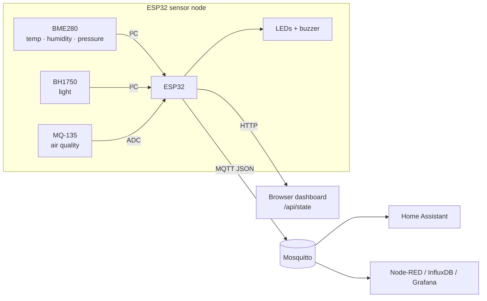

# ESP32 IoT Environmental Monitor


A Wi-Fi sensor node that measures **temperature, humidity, pressure, light and air quality**. It publishes readings over MQTT (with Home Assistant auto-discovery), serves a live dashboard on the local network, and raises LED/buzzer alerts when thresholds are crossed.

## System Architecture



## Features

- **5 measurements** from 3 sensors, each averaged over several samples to smooth out noise
- **MQTT** JSON publishing with retained state, and **Last Will** so the broker knows when the node goes offline
- **Home Assistant auto-discovery**: sensors appear in HA automatically, with no YAML to write
- **Remote commands** on `home/envmon-01/cmd` (`publish`, `restart`)
- **Built-in web dashboard** at `http://<device-ip>/`, plus JSON API at `/api/state` and `/api/health`
- **Local alerting**: red LED + buzzer on high/low temperature, high humidity or poor air quality
- **Resilient**: Wi-Fi auto-reconnect, non-blocking MQTT reconnect, keeps working when a sensor is missing
- **Secrets kept out of git** via `include/secrets.h` (git-ignored)

## Example Payload

```json
{
  "device": "envmon-01",
  "timestamp": 1759240800,
  "temperature": 22.84,
  "humidity": 41.2,
  "pressure": 1012.6,
  "lux": 318,
  "air_quality": 812,
  "alert": false,
  "alert_reason": "",
  "rssi": -58,
  "uptime_s": 86400
}
```

## Hardware

| Part | Qty | Approx. cost |
|---|---|---|
| ESP32 DevKit v1 | 1 | $8 |
| BME280 module (I²C, 3.3 V) | 1 | $5 |
| BH1750 light sensor | 1 | $2 |
| MQ-135 gas sensor module | 1 | $3 |
| LEDs (green, red) + 220 Ω resistors | 2 | <$1 |
| Piezo buzzer | 1 | <$1 |
| 10 kΩ + 20 kΩ resistors (divider) | 2 | <$1 |

Full pin map: [`docs/wiring.md`](docs/wiring.md). A custom PCB for this circuit is in [kicad-sensor-board](https://github.com/abdurrafayk900-ship-it/kicad-sensor-board).

## Getting Started

1. Install [PlatformIO](https://platformio.org/) (VS Code extension or CLI).
2. Clone the repo and create your secrets file:
   ```bash
   git clone https://github.com/abdurrafayk900-ship-it/esp32-env-monitor.git
   cd esp32-env-monitor
   cp include/secrets.example.h include/secrets.h   # edit Wi-Fi + MQTT details
   ```
3. Build, flash and watch the serial output:
   ```bash
   pio run -t upload
   pio device monitor
   ```
4. Open `http://<device-ip>/` or watch MQTT:
   ```bash
   mosquitto_sub -h <broker> -t 'home/envmon-01/#' -v
   ```

## Configuration

All tunables are in [`include/config.h`](include/config.h): publish interval, pins, I²C addresses, alert thresholds and MQTT topics.

## Project Structure

```
├── include/
│   ├── config.h             # pins, thresholds, topics
│   └── secrets.example.h    # template for Wi-Fi/MQTT credentials
├── src/main.cpp             # firmware
├── docs/wiring.md           # pin map and hardware notes
└── platformio.ini           # board + library dependencies
```

## Roadmap

- [ ] Deep-sleep mode for battery operation
- [ ] OTA firmware updates
- [ ] InfluxDB + Grafana dashboard template
- [ ] MQTT over TLS

## References

- [Adafruit BME280 library](https://github.com/adafruit/Adafruit_BME280_Library)
- [BH1750 library by claws](https://github.com/claws/BH1750)
- [PubSubClient](https://github.com/knolleary/pubsubclient)
- [Home Assistant MQTT discovery](https://www.home-assistant.io/integrations/mqtt/#mqtt-discovery)

## License

MIT
